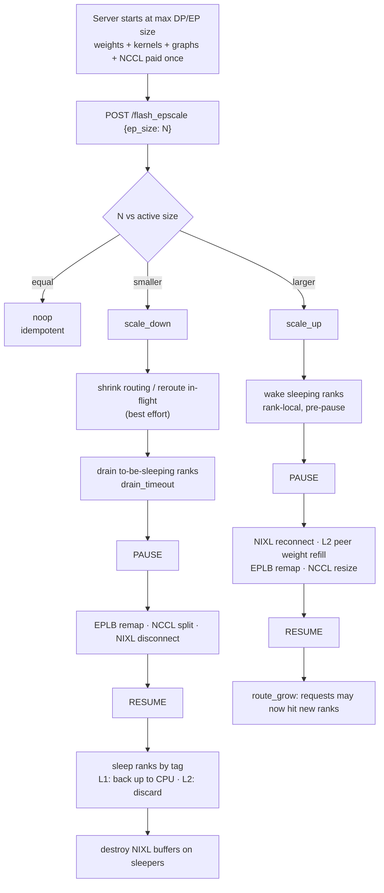

<div align="center">

# vLLM-FastEEP

**Fast intra-instance elastic scaling for expert-parallel MoE serving.**

A vLLM fork that keeps workers, kernels, CUDA graphs and the parent NCCL
communicator alive, and only resizes the *active* expert-parallel group —
turning a 30–50 s EP rebuild into a **2–4 s** transition.

[](https://github.com/vllm-project/vllm/tree/fcae5c98870ff2c20659731dce7ba3a3ff0d48aa)
[](https://github.com/vllm-project/vllm/pull/44994)
[](https://arxiv.org/abs/2610.18451)
[](LICENSE)

[English](README.md) · [简体中文](README.zh-CN.md) · [Feature docs](docs/features/flash_ep_scaling.md) · [Upstream tracking](UPSTREAM.md)

</div>

---

## TL;DR

```bash
# 1. Start serving at the MAXIMUM EP size you may ever need.
VLLM_SERVER_DEV_MODE=1 vllm serve <model> \
    --enable-sleep-mode --enable-expert-parallel --enable-eplb --enable-elastic-ep \
    --all2all-backend nixl_ep --data-parallel-backend ray \
    --data-parallel-size 8 --data-parallel-size-local 8

# 2. Resize the active group while it serves. No restart, no reload.
curl -X POST localhost:8005/flash_epscale -d '{"ep_size": 4, "level": 2}'
```

---

## Why FastEEP?

MoE inference is bursty. Expert parallelism (EP) shards experts across GPUs, so
the deployment size decides how much GPU memory and NVLink bandwidth is
committed — and a static EP size must be provisioned for peak. Idle at night,
the cluster still burns 8 GPUs per replica.

Elastic EP in vLLM can already change the topology, but every transition
rebuilds workers, reloads and resplits weights, re-captures CUDA graphs and
re-forms NCCL communicators. That costs tens of seconds and drops in-flight
work.

FastEEP avoids the rebuild. The server **starts at the maximum DP/EP size** and
pays startup once: weight load, kernel compile, graph capture, NCCL topology. A
scale event then only reconfigures the active subset:

| | ElasticEP (topology change) | **FastEEP (partial reuse)** |
| --- | --- | --- |
| Worker processes | recreated | reused |
| Compiled kernels / CUDA graphs | re-captured | reused (graph pool offloaded & restored) |
| Weights | reloaded | kept, or refilled from active peers |
| Comm state | rebuilt | parent group retained, `ncclCommSplit` for the active subset |
| Range | beyond the startup size | within the startup size |
| Scale latency (8×H20, measured) | 6.8–50.6 s | **1.8–3.9 s** |

---

## Benchmarks

End-to-end latency of a single `/flash_epscale` call, measured on one node of
8×H20-96G, `TP=1`, `--enforce-eager`, `--gpu-memory-utilization 0.45`,
`--max-model-len 4096`, 64 redundant experts, NIXL EP + PyNCCL weight
migration. ElasticEP numbers come from the same setup for reference.

| Model | Transition | ElasticEP | **FastEEP** | Speed-up |
| --- | --- | ---: | ---: | ---: |
| DeepSeek-V2-Lite | scale up 2 → 4 | 31.2 s | **2.6 s** | 12.0× |
| DeepSeek-V2-Lite | scale down 4 → 2 | 6.8 s | **1.8 s** | 3.8× |
| Qwen3-30B-A3B | scale up 2 → 4 | 37.4 s | **3.4 s** | 11.0× |
| Qwen3-30B-A3B | scale down 4 → 2 | 8.3 s | **2.7 s** | 3.1× |
| DeepSeek-V2-Lite | scale up 4 → 6 | 44.8 s | **3.9 s** | 11.5× |
| DeepSeek-V2-Lite | scale down 6 → 4 | 14.5 s | **3.5 s** | 4.1× |
| DeepSeek-V2-Lite | scale up 2 → 6 | 50.6 s | **3.0 s** | 16.9× |
| DeepSeek-V2-Lite | scale down 6 → 2 | 9.9 s | **2.3 s** | 4.3× |

> Numbers were reported by the authors on the hardware above and will shift
> with model, GPU, NIXL version and memory mode. Re-measure on your own stack:
> every response carries a per-step `timing_ms` breakdown so you can attribute
> the transition cost yourself.

---

## How it works



Two invariants make this safe:

1. **Collectives only run inside a short pause window.** Everything that must
   not interleave with forward passes (NCCL resize, EPLB remap, NIXL
   connect/disconnect, L2 refill) runs between engine pause and resume.
   Draining, CPU backup and memory release happen outside it, so active ranks
   keep serving for most of the transition.
2. **Routing is monotone with readiness.** Scale-down shrinks routing before
   draining; scale-up grows routing only after the transition finished. A
   request never lands on a rank whose communicator is still being resized.

### Mechanisms

- **Communication memory reclaim.** `ncclCommSplit` off a retained max-DP
  parent communicator, so only the active subset talks; obsolete split
  communicators are destroyed. Where `ncclCommSuspend`/`ncclCommResume` are
  available, the parent's GPU resources are released and restored without
  losing the handle. Sleeping NIXL peers are masked, disconnected and their
  RDMA buffers destroyed, then rebuilt and reconnected on wake.
- **CUDA graph buffer reclaim.** Capture allocations are routed into a
  dedicated CuMem `graphs` pool. On sleep the pool is backed up to pinned host
  memory and its GPU pages are unmapped; on wake it is remapped at the *same*
  virtual addresses, so captured graphs stay valid and are never re-captured.
- **Tagged memory sleep.** Allocations are separated into `shared_weights`,
  `expert_weights` and `kv_cache` (plus `graphs`), so a transition can offload
  or restore subsets independently. Level 1 backs up to CPU; level 2 discards
  and refills from active peers on wake. Pinned backup buffers are reused
  across cycles.
- **EPLB logical sleep + V2 runner.** Sleeping ranks keep their logical expert
  assignment but skip forward execution; expert placement is remapped in the
  same step as the communicator resize, and only when the target configuration
  is consistent.
- **Cheap scale-up.** Shared weights are refilled only on joining ranks,
  transfers are distributed across active senders, and KV cache stays unmapped
  on ranks that remain asleep.

---

## Installation

FastEEP is a vLLM source tree. Install it like vLLM, editable, from this repo:

```bash
git clone https://github.com/nanookfyf/Vllm-FastEEP
cd Vllm-FastEEP

uv venv --python 3.12 --seed --managed-python
source .venv/bin/activate

# Reuse the published vLLM binaries (.so) for a fast source build.
VLLM_USE_PRECOMPILED=1 uv pip install --editable . -v

# FastEEP runtime dependencies
uv pip install meson ninja pybind11 tomlkit 'ray[default]' nixl-cu13==1.0.1
```

Notes:

- `VLLM_USE_PRECOMPILED=1` avoids a multi-hour CUDA build. Drop it only if you
  need to change kernels under `csrc/`.
- This repo has a single release tag (`v0.31.0`, the upstream baseline), so the
  editable install derives its version from it; that affects the version string
  only. Use `SETUPTOOLS_SCM_PRETEND_VERSION` for a specific value.
- PyNCCL expert-weight migration and the NIXL EP backend are hard requirements
  for the fast path, not optional extras.

---

## Quickstart

### 1. Start Ray

```bash
export RAY_ADDRESS="127.0.0.1:9305"
if ! timeout 10s ray status --address="$RAY_ADDRESS" >/dev/null 2>&1; then
    ray start --head --port=9305 --disable-usage-stats
fi
ray status --address="$RAY_ADDRESS"
```

### 2. Serve at the maximum size

```bash
export VLLM_SERVER_DEV_MODE=1
export VLLM_FLASH_EPSCALE_SUSPEND_MAX_DP=1     # reclaim the parent comm's GPU memory
export VLLM_FLASH_EPSCALE_SKIP_NIXL_TEARDOWN=0 # tear down NIXL buffers on sleepers

MODEL=/path/to/DeepSeek-V2-Lite   # or Qwen3-30B-A3B

vllm serve "$MODEL" \
    --trust-remote-code --enable-sleep-mode \
    --host 0.0.0.0 --port 8005 \
    --tensor-parallel-size 1 \
    --gpu-memory-utilization 0.45 \
    --max-model-len 4096 --no-enable-prefix-caching \
    --enable-expert-parallel --enable-eplb --enable-elastic-ep \
    --all2all-backend nixl_ep \
    --eplb-config.num_redundant_experts 64 \
    --eplb-config.communicator pynccl \
    --eplb-config.use_async false \
    --data-parallel-backend ray --distributed-executor-backend ray \
    --data-parallel-size 8 --data-parallel-size-local 8 \
    --data-parallel-rpc-port 9876 --data-parallel-start-rank 0 \
    --enforce-eager
```

### 3. Scale down to 4, then back up to 8

```bash
curl -X POST http://localhost:8005/flash_epscale \
  -H 'Content-Type: application/json' \
  -d '{"ep_size": 4, "level": 2}'

curl -X POST http://localhost:8005/flash_epscale \
  -H 'Content-Type: application/json' \
  -d '{"ep_size": 8}'
```

### 4. Verify correctness across the transition

```bash
curl http://localhost:8005/v1/completions \
  -H 'Content-Type: application/json' \
  -d '{"model":"<served-model-name>","prompt":"Explain expert parallelism in one sentence.","max_tokens":32}'
```

---

## API

### `POST /flash_epscale`

Resize the active EP group. Calls are serialized by a server-side lock: a
second request waits for the first transition to finish, and asking for the
current size is an idempotent `noop`.

> **Security.** Like every `VLLM_SERVER_DEV_MODE` endpoint, `/flash_epscale` is
> unauthenticated: anyone who can reach it can resize — and thereby degrade or
> deny service to — the instance. Keep dev mode behind a private network or an
> authenticating proxy. See [`docs/usage/security.md`](docs/usage/security.md).

| Field | Type | Default | Description |
| --- | --- | --- | --- |
| `ep_size` | int | **required** | Target active EP size, in `[1, ep_world_size]`. |
| `level` | `1` \| `2` | `1` | Memory mode for ranks that sleep or wake: `1` = CPU backup, `2` = discard + peer refill. |
| `tags` | list[str] | `["shared_weights", "expert_weights", "kv_cache"]` | CuMem tags to offload (scale-down) or restore (scale-up). `"weights"` expands to `shared_weights + expert_weights`. |
| `drain_timeout` | float (s) | `300` | How long to wait for in-flight requests on to-be-sleeping ranks. Scale-down only. |

Response:

```json
{
  "ok": true,
  "ep_world_size": 8,
  "active_ep_size": 4,
  "sleeping_ep_ranks": [4, 5, 6, 7],
  "changed": true,
  "action": "scale_down",
  "tags": ["shared_weights", "expert_weights", "kv_cache"],
  "timing_ms": {
    "query_state": 12.4, "route_shrink": 0.6, "reroute": 3.1, "drain": 41.7,
    "pause": 8.9, "warm_backup": 5.2, "resize": 640.3,
    "nixl_disconnect": 11.8, "resume": 9.5, "sleep": 1120.2,
    "nixl_destroy": 6.4, "final_state": 18.0, "total": 1878.1
  }
}
```

| Field | Meaning |
| --- | --- |
| `action` | `noop` \| `scale_up` \| `scale_down`. |
| `changed` | `false` for `noop`. |
| `sleeping_ep_ranks` | Suffix of the world that is currently offloaded. |
| `timing_ms` | Per-step wall time in milliseconds; keys that did not run are absent. `reroute_count` is a count, not a timing. |

Step reference:

| Key | Phase | What it measures |
| --- | --- | --- |
| `query_state` / `final_state` | pre / post | EP sleep-state query across workers. |
| `route_shrink` / `route_grow` | outside pause | Front-end active-DP routing update. |
| `reroute` | outside pause | Best-effort re-issue of in-flight requests off shrinking ranks. |
| `drain` | outside pause | Wait for the shrinking ranks to go idle. |
| `pause` / `resume` | boundary | Stop-the-world enter/exit for forward collectives. |
| `wake` | pre-pause | Rank-local CuMem wake of already-sleeping ranks. |
| `warm_backup` | pre-pause | Pre-pin host backup buffers for the incoming sleep (best effort). |
| `resize` | **in pause** | EPLB remap + NCCL split/resize + NIXL mask. |
| `nixl_ensure` / `nixl_disconnect` | **in pause** | Rebuild/reconnect peers, or forget sleeping peers' endpoints. |
| `l2_refill` | **in pause** | L2 only: dense-weight and EPLB-map refill from active peers. |
| `sleep` | post-resume | Rank-local CuMem sleep (L1 copy-out / L2 discard) on new sleepers. |
| `nixl_destroy` | post-resume | Destroy RDMA buffers of new sleepers. |
| `rollback` | on failure | Best-effort revert of a failed transition. |

Errors:

- `400` — `ep_size` outside `[1, ep_world_size]`, malformed `level`, `tags` or
  `drain_timeout`.
- `404` — `VLLM_SERVER_DEV_MODE` is not set, so the router is not registered.
- `500` — workers reported inconsistent EP state, or a step inside the pause
  window failed. The endpoint resumes the engine before returning; a resume
  failure is surfaced instead of being reported as success.

### Helper endpoints

Used by `/flash_epscale` internally; callable directly for scripted recovery.

| Endpoint | Body | Effect |
| --- | --- | --- |
| `POST /sleep_ep_ranks_tags` | `{"sleeping_ep_ranks": [4,5,6,7], "tags": ["expert_weights","kv_cache"], "level": 1}` | Offload the listed ranks/tags. |
| `POST /wake_up_ep_ranks_tags` | same shape | Restore the listed ranks/tags. |

These do **not** update routing or EPLB state — they are low-level building
blocks. Prefer `/flash_epscale` unless you are implementing a recovery flow.

---

## Configuration

| Variable / flag | Default | Purpose |
| --- | --- | --- |
| `VLLM_SERVER_DEV_MODE` | `0` | Registers `/flash_epscale` and the sleep-by-tag helpers. |
| `VLLM_FLASH_EPSCALE_SUSPEND_MAX_DP` | `1` | After a scale-down, suspend the retained max-DP communicator so its GPU buffers are released (restored with `ncclCommResume`). `0` trades memory for lower recovery latency. |
| `VLLM_FLASH_EPSCALE_SKIP_NIXL_TEARDOWN` | `0` | `1` keeps sleeping ranks' NIXL buffers registered (disconnect still happens). Lower latency, more memory held. |
| `--enable-sleep-mode` | off | Required; the offload path reuses sleep/wake. |
| `--enable-elastic-ep` | off | Required; enables routing requests away from to-be-sleeping DP ranks. |
| `--all2all-backend nixl_ep` | `allgather_reducescatter` | Required; peer masking on scale-down is NIXL-specific. |
| `--eplb-config.communicator` | backend default | `pynccl` for the tested L2 peer-refill path. |
| `--eplb-config.use_async` | `true` | Must be `false` with the `pynccl` communicator. |
| `--gpu-memory-utilization` | `0.92` | Lower it (≈`0.45` for 30B-A3B on 96 GB) so the wake path can reallocate. |

**Tuning presets.** Memory-first: `VLLM_FLASH_EPSCALE_SUSPEND_MAX_DP=1`,
`VLLM_FLASH_EPSCALE_SKIP_NIXL_TEARDOWN=0`, `level=2`. Latency-first:
`VLLM_FLASH_EPSCALE_SUSPEND_MAX_DP=0`,
`VLLM_FLASH_EPSCALE_SKIP_NIXL_TEARDOWN=1`, `level=1`. Report the preset
alongside any benchmark you publish.

---

## Testing

The FastEEP tests need 8 GPUs and a CUDA build.

```bash
# Endpoint behavior: parameter validation, noop/idempotency, scale down/up,
# state mismatch handling, timing payload.
.venv/bin/python -m pytest -v tests/entrypoints/serve/test_flash_epscale.py

.venv/bin/python -m pytest -v tests/entrypoints/serve/test_sleep_ep_rank_tags.py
.venv/bin/python -m pytest -v tests/distributed/test_pynccl_comm_split.py
.venv/bin/python -m pytest -v tests/distributed/test_eplb_logical_sleep.py
.venv/bin/python -m pytest -v tests/basic_correctness/test_cumem_allocator.py
.venv/bin/python -m pytest -v tests/v1/worker/test_gpu_model_runner_v2_eplb.py
```

`tools/fasteep/repro_nccl_buf.py` is a standalone reproduction that separates
`ncclCommInitRank` (structural) from channel-buffer allocation; it is useful
when debugging a communicator-split hang on a new driver or NCCL version.

---

## Limitations

- **Bounded by startup size.** FastEEP only resizes the active subset of the
  topology built at startup; growing beyond it still needs ElasticEP.
- **Processes and CUDA contexts stay resident.** This is partial reuse, not
  scale-to-zero; pid count and per-rank state are unchanged.
- **Enough active slots must exist** to place every logical expert; the minimum
  viable `ep_size` is model- and redundancy-dependent.
- **Single node, `TP=1` only** in the current validation. Multi-node, TP/PP and
  mixed prefill/decode are untested.
- **CUDA graph reclaim requires** `enable_cumem_allocator=True` and capture into
  the CuMem graph pool; the eager quickstart above does not exercise it.
- **L1 first call** allocates pinned host memory and can take ~20 s; later calls
  reuse the buffer.
- **L2 + NIXL weight migration** hit UCX failures on repeated wake cycles with
  NIXL 1.0.1; the tested configuration uses synchronous PyNCCL instead.
- **`--enforce-eager` reduces risk** on the wake path; graph replay validation
  is still in progress.

### Roadmap

- [x] L2 peer weight refill (avoid CPU backup for weights/KV).
- [x] Keep active ranks serving outside the pause window.
- [ ] Integrate with ElasticEP for targets beyond the startup maximum.
- [ ] Validate CUDA graph replay, TP, and other parallel modes.
- [ ] Multi-node and continuous-batching stress tests.

---

## Upstream tracking

| | |
| --- | --- |
| Upstream base | `vllm-project/vllm@fcae5c9` (2026-10-11, post-`v0.31.0`) |
| PR branch | `nanookfyf/vllm:flash_epscale-cleanup-pause-fix` @ `527350d` (22 commits) |
| Patch | `vllm-project/vllm#44994` — see [`UPSTREAM.md`](UPSTREAM.md) |

The code history is three commits so the delta stays legible:

```
01cf7ed  Import vLLM upstream snapshot at fcae5c9
51e912a  Add FastEEP: fast intra-instance elastic EP scaling
233eec0  Repo hygiene: drop stray npm files, move NCCL repro under tools/fasteep
```

To pull in newer upstream work:

```bash
git remote add upstream https://github.com/vllm-project/vllm.git  # once
git fetch upstream
git diff upstream/main -- docs/features/flash_ep_scaling.md \
    vllm/entrypoints/serve/flash_epscale vllm/distributed/elastic_ep/peer_weight_transfer.py
```

The re-appliable diff against the base commit is stored in
[`docs/fasteep/fasteep.patch`](docs/fasteep/fasteep.patch), so the feature can
be rebased onto a newer vLLM with `git apply -3`.

---

## Citation

```bibtex
@misc{feng2026fasteep,
  title  = {FastEEP: Fast Intra-Instance Elastic Scaling for Expert-Parallel MoE Serving},
  author = {Feng, Yunfei and He, Jingkai and Liu, Shiqi and Zhang, Cheng and Du, Dong and Feng, Erhu},
  year   = {2026},
  eprint = {2610.18451},
  archivePrefix = {arXiv}
}
```

## Acknowledgements

- [vLLM](https://github.com/vllm-project/vllm) — this fork is the upstream
  serving stack plus the FastEEP patch.
- [Elastic Expert Parallelism](https://vllm.ai/blog/2026-05-14-elastic-expert-parallelism)
  and [sleep mode](https://vllm.ai/blog/2025-10-26-sleep-mode), whose primitives
  FastEEP reuses.
- [NIXL](https://github.com/ai-dynamo/nixl) for the transfer backend.
- FastEEP was implemented by Yunfei Feng, Jingkai He, Shiqi Liu, Cheng Zhang,
  Dong Du and Erhu Feng (Shanghai Jiao Tong University).
