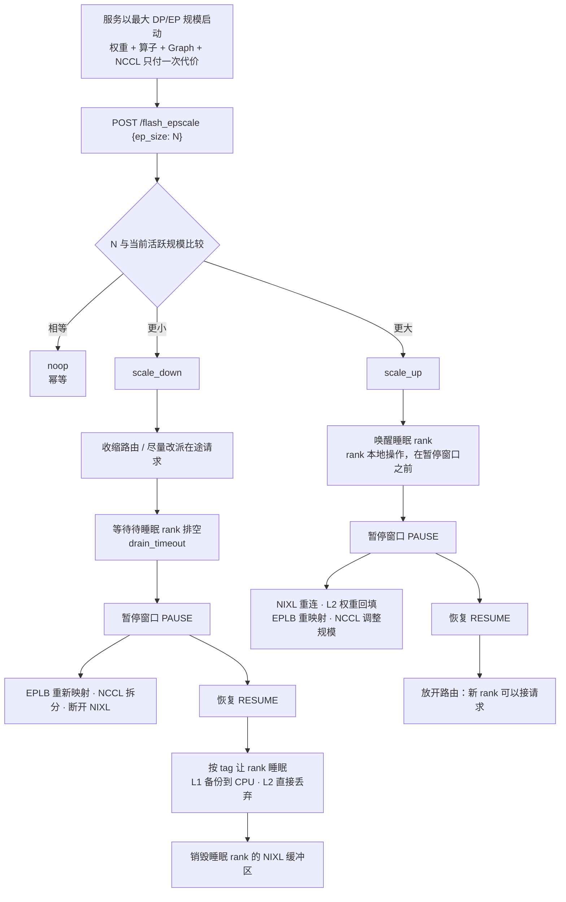

<div align="center">

# vLLM-FastEEP

**面向专家并行（EP）MoE 推理的实例内快速弹性扩缩容。**

这是 vLLM 的一个分支：保留 worker 进程、已编译算子、CUDA Graph 和父 NCCL
通信域，只调整**活跃**的专家并行子集，把一次 30–50 s 的 EP 重建压缩到
**2–4 s**。

[](https://github.com/vllm-project/vllm/tree/fcae5c98870ff2c20659731dce7ba3a3ff0d48aa)
[](https://github.com/vllm-project/vllm/pull/44994)
[](https://arxiv.org/abs/2610.18451)
[](LICENSE)
[](pyproject.toml)

[English](README.md) · [简体中文](README.zh-CN.md) · [特性文档](docs/features/flash_ep_scaling.md) · [上游追踪](UPSTREAM.md)

</div>

---

## 一分钟上手

```bash
# 1. 以“未来可能用到的最大 EP 规模”启动服务。
VLLM_SERVER_DEV_MODE=1 vllm serve <model> \
    --enable-sleep-mode --enable-expert-parallel --enable-eplb --enable-elastic-ep \
    --all2all-backend nixl_ep --data-parallel-backend ray \
    --data-parallel-size 8 --data-parallel-size-local 8

# 2. 服务不停机、不重载，直接缩容。
curl -X POST localhost:8005/flash_epscale -d '{"ep_size": 4, "level": 2}'
```

服务进程组里仍然是 8 个 EP rank，但只有 4 个在路由、只有 4 个占着显存。再扩容到
8 时走的是“唤醒睡眠 rank”，而不是重建。

---

## 为什么需要 FastEEP

MoE 推理负载是突发式的。专家并行把专家切分到多张 GPU 上，部署规模直接决定了
占用的显存与 NVLink 带宽，因此静态 EP 规模必须按峰值配置——夜深空闲时，每个副本
的 8 张卡仍然被占着。

vLLM 的 ElasticEP 已经能改变拓扑，但每次切换都要重建 worker、重新加载/重切权重、
重新捕获 CUDA Graph、重新建立 NCCL 通信域，代价是几十秒，并且会打断在途请求。

FastEEP 的思路是**不做重建**：服务**以最大 DP/EP 规模启动**，把权重加载、算子编译、
Graph 捕获、NCCL 拓扑这些代价只付一次；之后的扩缩容只重配活跃子集。

| | ElasticEP（拓扑变更） | **FastEEP（部分复用）** |
| --- | --- | --- |
| worker 进程 | 重建 | 复用 |
| 已编译算子 / CUDA Graph | 重新捕获 | 复用（graph pool 卸载后原位恢复） |
| 权重 | 重新加载 | 保留，或从活跃 peer 回填 |
| 通信状态 | 重建 | 保留父通信域，用 `ncclCommSplit` 切出活跃子集 |
| 适用范围 | 可以超过启动规模 | 不超过启动规模 |
| 扩容/缩容延迟（8×H20 实测） | 6.8–50.6 s | **1.8–3.9 s** |

两者的定位是互补的：FastEEP 负责最常见的“在单机内重新分配算力”，ElasticEP 负责
“长到启动规模之外”。

---

## 性能数据

下表是单次 `/flash_epscale` 调用的端到端延迟，测试环境为单机 8×H20-96G，`TP=1`，
`--enforce-eager`，`--gpu-memory-utilization 0.45`，`--max-model-len 4096`，
64 个冗余专家，NIXL EP + PyNCCL 权重迁移。ElasticEP 一列为同一环境下的对照。

| 模型 | 切换 | ElasticEP | **FastEEP** | 加速比 |
| --- | --- | ---: | ---: | ---: |
| DeepSeek-V2-Lite | 扩容 2 → 4 | 31.2 s | **2.6 s** | 12.0× |
| DeepSeek-V2-Lite | 缩容 4 → 2 | 6.8 s | **1.8 s** | 3.8× |
| Qwen3-30B-A3B | 扩容 2 → 4 | 37.4 s | **3.4 s** | 11.0× |
| Qwen3-30B-A3B | 缩容 4 → 2 | 8.3 s | **2.7 s** | 3.1× |
| DeepSeek-V2-Lite | 扩容 4 → 6 | 44.8 s | **3.9 s** | 11.5× |
| DeepSeek-V2-Lite | 缩容 6 → 4 | 14.5 s | **3.5 s** | 4.1× |
| DeepSeek-V2-Lite | 扩容 2 → 6 | 50.6 s | **3.0 s** | 16.9× |
| DeepSeek-V2-Lite | 缩容 6 → 2 | 9.9 s | **2.3 s** | 4.3× |

> 上述数据由论文作者在上述硬件上测得，会随模型、GPU、NIXL 版本和内存模式变化。
> 请在自己的环境重新测量：每次响应都带有分步 `timing_ms`，可以直接定位耗时来源。

---

## 工作原理



安全性由两条不变量保证：

1. **集合通信只发生在短暂的暂停窗口内。** 所有不能与前向计算交错的步骤（NCCL
   调整规模、EPLB 重映射、NIXL 连接/断开、L2 回填）都夹在引擎 pause 与 resume
   之间；排空、CPU 备份、显存释放都放在窗口之外，因此活跃 rank 在切换的大部分
   时间里仍在出 token。
2. **路由变化与就绪状态单调一致。** 缩容先收缩路由再排空；扩容只在切换完成后才
   放开路由。请求不会落到一个通信域仍在调整的 rank 上。

### 关键机制

- **通信显存回收。** 保留一个最大 DP 父通信域，用 `ncclCommSplit` 切出活跃子集，
  过期的 split 通信域随缩容销毁。若 NCCL 支持 `ncclCommSuspend`/`ncclCommResume`，
  则在不丢失 handle 的前提下释放/恢复父通信域的显存。睡眠 rank 的 NIXL peer 会被
  mask、断开并销毁 RDMA 缓冲区，唤醒时再重建重连。
- **CUDA Graph 缓冲区回收。** Graph 捕获期分配统一走独立的 CuMem `graphs` pool：
  睡眠时把内容备份到 pinned 主机内存并 unmap，唤醒时在同一虚拟地址上 remap，因此
  已捕获的 Graph 始终有效，无需重新捕获。
- **带 tag 的内存睡眠。** 分配被区分为 `shared_weights`、`expert_weights`、
  `kv_cache`（以及 `graphs`），因此可以按子集卸载/恢复。L1 备份到 CPU；L2 直接
  丢弃，唤醒时从活跃 peer 回填。pinned 备份缓冲区跨多轮复用。
- **EPLB 逻辑睡眠 + V2 Runner。** 睡眠 rank 保留逻辑专家分配但跳过前向执行；专家
  放置与通信域调整在同一步内完成，且只有在目标配置一致时才执行。
- **更省的扩容。** 共享权重只回填到新加入的 rank，传输分摊到多个活跃发送方，仍然
  睡眠的 rank 不重新映射 KV cache。

### 内存模式

| 模式 | 请求参数 | 回收的内容 | CPU 代价 | 典型场景 |
| --- | --- | --- | --- | --- |
| **L1** | `"level": 1`（默认） | 各 tag 分配的 GPU 页，内容备份到 pinned CPU | 每个睡眠 rank 的权重 + KV cache | 切换次数少、可预测；唤醒更快 |
| **L2** | `"level": 2` | 只回收 GPU 页，内容**丢弃** | 仅 graph pool 备份 | CPU 紧张的机器；唤醒时从活跃 peer 回填权重 |

在当前验证过的配置里，L2 需要 `--eplb-config.communicator pynccl` 与
`--eplb-config.use_async false`，因为 peer 回填走的是同步 PyNCCL 传输。

---

## 环境要求

| | 要求 |
| --- | --- |
| 硬件 | 单机、同构 GPU。已在 8×H20-96G 上验证，需要 CUDA + NVLink 级互连。 |
| 并行方式 | `TP=1`，DP 规模等于 EP world size，`--data-parallel-backend ray`。多机与 TP **尚未验证**。 |
| 模型 | 由 EPLB 管理的 MoE（已验证 DeepSeek-V2-Lite、Qwen3-30B-A3B）。 |
| vLLM 参数 | `--enable-sleep-mode`、`--enable-expert-parallel`、`--enable-eplb`、`--enable-elastic-ep`、`--all2all-backend nixl_ep` |
| 运行时 | Ray、NIXL（验证版本 `nixl-cu13==1.0.1`）、用于专家权重迁移的 PyNCCL |
| 环境变量 | `VLLM_SERVER_DEV_MODE=1` —— `/flash_epscale` 是 dev 接口，不开这个变量不会注册 |

30B-A3B 级别的 MoE 在 96 GB 卡上使用 `--gpu-memory-utilization 0.45` 可以为唤醒
路径留出足够余量；显存更紧张时请优先使用 L2。

---

## 安装

FastEEP 就是一份 vLLM 源码树，用和 vLLM 相同的方式以 editable 模式安装：

```bash
git clone https://github.com/<you>/Vllm-FastEEP.git
cd Vllm-FastEEP

uv venv --python 3.12 --seed --managed-python
source .venv/bin/activate

# 复用官方预编译产物（.so），避免数小时的 CUDA 源码编译。
VLLM_USE_PRECOMPILED=1 uv pip install --editable . -v

# FastEEP 运行时依赖
uv pip install meson ninja pybind11 tomlkit 'ray[default]' nixl-cu13==1.0.1
```

说明：

- `VLLM_USE_PRECOMPILED=1` 只跳过编译，不影响 FastEEP 的 Python 侧改动；只有需要
  修改 `csrc/` 下的算子时再去掉它。
- 本仓库只保留了一个基线 tag（`v0.31.0`），editable 安装的版本号由它推导，仅影响
  版本字符串；需要固定版本时可用 `SETUPTOOLS_SCM_PRETEND_VERSION`。
- PyNCCL 专家权重迁移与 NIXL EP 后端是快速路径的硬性依赖，不是可选插件。

---

## 快速开始

### 1. 启动 Ray

```bash
export RAY_ADDRESS="127.0.0.1:9305"
if ! timeout 10s ray status --address="$RAY_ADDRESS" >/dev/null 2>&1; then
    ray start --head --port=9305 --disable-usage-stats
fi
ray status --address="$RAY_ADDRESS"
```

### 2. 以最大规模启动服务

```bash
export VLLM_SERVER_DEV_MODE=1
export VLLM_FLASH_EPSCALE_SUSPEND_MAX_DP=1     # 回收父通信域显存
export VLLM_FLASH_EPSCALE_SKIP_NIXL_TEARDOWN=0 # 睡眠时销毁 NIXL 缓冲区

MODEL=/path/to/DeepSeek-V2-Lite   # 也可以是 Qwen3-30B-A3B

vllm serve "$MODEL" \
    --trust-remote-code --enable-sleep-mode \
    --host 0.0.0.0 --port 8005 \
    --tensor-parallel-size 1 \
    --gpu-memory-utilization 0.45 \
    --max-model-len 4096 --no-enable-prefix-caching \
    --enable-expert-parallel --enable-eplb --enable-elastic-ep \
    --all2all-backend nixl_ep \
    --eplb-config.num_redundant_experts 64 \
    --eplb-config.communicator pynccl \
    --eplb-config.use_async false \
    --data-parallel-backend ray --distributed-executor-backend ray \
    --data-parallel-size 8 --data-parallel-size-local 8 \
    --data-parallel-rpc-port 9876 --data-parallel-start-rank 0 \
    --enforce-eager
```

### 3. 缩容到 4，再扩回 8

```bash
curl -X POST http://localhost:8005/flash_epscale \
  -H 'Content-Type: application/json' \
  -d '{"ep_size": 4, "level": 2}'

curl -X POST http://localhost:8005/flash_epscale \
  -H 'Content-Type: application/json' \
  -d '{"ep_size": 8}'
```

### 4. 校验切换前后的正确性

```bash
curl http://localhost:8005/v1/completions \
  -H 'Content-Type: application/json' \
  -d '{"model":"<served-model-name>","prompt":"Explain expert parallelism in one sentence.","max_tokens":32}'
```

在切换前后发同一个 prompt 并对比输出，正常情况下差异只应来自采样噪声。

### 5. 用 Python 驱动

```python
import time
import requests


def scale(ep_size: int, level: int = 1) -> dict:
    t0 = time.perf_counter()
    resp = requests.post(
        "http://localhost:8005/flash_epscale",
        json={"ep_size": ep_size, "level": level},
        timeout=600,
    )
    resp.raise_for_status()
    body = resp.json()
    print(
        f"{body['action']:<10} active={body['active_ep_size']} "
        f"sleeping={body['sleeping_ep_ranks']} "
        f"total={body['timing_ms']['total']:.0f}ms "
        f"(wall {1000 * (time.perf_counter() - t0):.0f}ms)"
    )
    return body


scale(4, level=2)   # 夜里缩容
scale(8)            # 早高峰扩容
```

`examples/fasteep/` 下有一份同样的封装脚本（`serve.sh`、`demo.py`）。

---

## 接口

### `POST /flash_epscale`

调整活跃 EP 规模。服务端用一把锁串行化请求：并发调用会排队等待，目标规模等于
当前规模时直接返回幂等的 `noop`。

> **安全提醒。** 和所有 `VLLM_SERVER_DEV_MODE` 接口一样，`/flash_epscale` 没有鉴权：
> 任何能访问它的人都可以改变实例规模，从而降低甚至中断服务。请把 dev 模式放在内网
> 或带鉴权的代理之后。参见 [`docs/usage/security.md`](docs/usage/security.md)。

| 字段 | 类型 | 默认值 | 说明 |
| --- | --- | --- | --- |
| `ep_size` | int | **必填** | 目标活跃 EP 规模，取值 `[1, ep_world_size]`。 |
| `level` | `1` \| `2` | `1` | 睡眠/唤醒的内存模式：`1` 备份到 CPU，`2` 丢弃后由 peer 回填。 |
| `tags` | list[str] | `["shared_weights", "expert_weights", "kv_cache"]` | 需要卸载（缩容）或恢复（扩容）的 CuMem tag；`"weights"` 会展开为 `shared_weights + expert_weights`。 |
| `drain_timeout` | float（秒） | `300` | 等待待睡眠 rank 上在途请求结束的超时，仅缩容使用。 |

响应示例：

```json
{
  "ok": true,
  "ep_world_size": 8,
  "active_ep_size": 4,
  "sleeping_ep_ranks": [4, 5, 6, 7],
  "changed": true,
  "action": "scale_down",
  "tags": ["shared_weights", "expert_weights", "kv_cache"],
  "timing_ms": {
    "query_state": 12.4, "route_shrink": 0.6, "reroute": 3.1, "drain": 41.7,
    "pause": 8.9, "warm_backup": 5.2, "resize": 640.3,
    "nixl_disconnect": 11.8, "resume": 9.5, "sleep": 1120.2,
    "nixl_destroy": 6.4, "final_state": 18.0, "total": 1878.1
  }
}
```

| 字段 | 含义 |
| --- | --- |
| `action` | `noop` / `scale_up` / `scale_down`。 |
| `changed` | `noop` 时为 `false`。 |
| `sleeping_ep_ranks` | 当前处于卸载状态的后缀 rank 列表。 |
| `timing_ms` | 分步耗时（毫秒）；本次未执行的步骤不会出现；其中 `reroute_count` 是计数而非耗时。 |

分步耗时对照：

| 字段 | 阶段 | 含义 |
| --- | --- | --- |
| `query_state` / `final_state` | 前 / 后 | 查询各 worker 的 EP 睡眠状态。 |
| `route_shrink` / `route_grow` | 暂停窗口外 | 前端活跃 DP 路由更新。 |
| `reroute` | 暂停窗口外 | 尽量把在途请求改派到活跃 rank。 |
| `drain` | 暂停窗口外 | 等待待睡眠 rank 排空。 |
| `pause` / `resume` | 窗口边界 | 进入/退出 stop-the-world，暂停前向集合通信。 |
| `wake` | 窗口前 | rank 本地唤醒此前已睡眠的 rank。 |
| `warm_backup` | 窗口前 | 预先 pin 住即将睡眠 rank 的备份缓冲区（best effort）。 |
| `resize` | **窗口内** | EPLB 重映射 + NCCL 拆分/调整规模 + NIXL mask。 |
| `nixl_ensure` / `nixl_disconnect` | **窗口内** | 重建/重连 peer，或让活跃 rank 忘记睡眠 peer 的端点。 |
| `l2_refill` | **窗口内** | 仅 L2：从活跃 peer 回填 dense 权重与 EPLB 映射。 |
| `sleep` | 恢复之后 | 新睡眠 rank 的 CuMem 睡眠（L1 拷出 / L2 丢弃）。 |
| `nixl_destroy` | 恢复之后 | 销毁新睡眠 rank 的 RDMA 缓冲区。 |
| `rollback` | 失败时 | 失败切换的 best-effort 回滚。 |

错误码：

- `400` —— `ep_size` 超出 `[1, ep_world_size]`，或 `level`/`tags`/`drain_timeout`
  格式非法。
- `404` —— 未设置 `VLLM_SERVER_DEV_MODE`，路由未注册。
- `500` —— 各 worker 报告的 EP 状态不一致，或窗口内某一步失败。接口会在返回前
  恢复引擎；若恢复本身失败，会如实报错而不是返回成功。

### 辅助接口

`/flash_epscale` 内部会用到，也可以在自定义恢复流程中直接调用。

| 接口 | 请求体 | 作用 |
| --- | --- | --- |
| `POST /sleep_ep_ranks_tags` | `{"sleeping_ep_ranks": [4,5,6,7], "tags": ["expert_weights","kv_cache"], "level": 1}` | 卸载指定 rank 的指定 tag。 |
| `POST /wake_up_ep_ranks_tags` | 同上 | 恢复指定 rank 的指定 tag。 |

这两个接口**不**更新路由与 EPLB 状态，属于底层原语；除非在写恢复流程，否则请优先
使用 `/flash_epscale`。

---

## 配置项

| 变量 / 参数 | 默认值 | 作用 |
| --- | --- | --- |
| `VLLM_SERVER_DEV_MODE` | `0` | 注册 `/flash_epscale` 与按 tag 睡眠的辅助接口。 |
| `VLLM_FLASH_EPSCALE_SUSPEND_MAX_DP` | `1` | 缩容后挂起保留的最大 DP 通信域，释放其显存（唤醒时 `ncclCommResume`）。设为 `0` 则以内存换更低的恢复延迟。 |
| `VLLM_FLASH_EPSCALE_SKIP_NIXL_TEARDOWN` | `0` | 设为 `1` 时保留睡眠 rank 的 NIXL 缓冲区（仍会断开连接）：延迟更低，占用更高。 |
| `--enable-sleep-mode` | 关 | 必需；卸载路径复用 sleep/wake 设施。 |
| `--enable-elastic-ep` | 关 | 必需；用于把请求从待睡眠 DP rank 上摘走。 |
| `--all2all-backend nixl_ep` | `allgather_reducescatter` | 必需；缩容时的 peer mask 依赖 NIXL。 |
| `--eplb-config.communicator` | 后端默认 | L2 回填路径验证过的取值是 `pynccl`。 |
| `--eplb-config.use_async` | `true` | 与 `pynccl` 搭配时必须为 `false`。 |
| `--gpu-memory-utilization` | `0.92` | 调低（30B-A3B / 96 GB 下约 `0.45`），给唤醒路径留出分配空间。 |

**调优预设。** 省内存优先：`VLLM_FLASH_EPSCALE_SUSPEND_MAX_DP=1`、
`VLLM_FLASH_EPSCALE_SKIP_NIXL_TEARDOWN=0`、`level=2`。低延迟优先：
`VLLM_FLASH_EPSCALE_SUSPEND_MAX_DP=0`、
`VLLM_FLASH_EPSCALE_SKIP_NIXL_TEARDOWN=1`、`level=1`。发布 benchmark 时请注明
所使用的预设。

---

## 相对上游 vLLM 的改动

51 个文件，+5142 / −348。

| 模块 | 路径 | 改动 |
| --- | --- | --- |
| Dev 接口 | `vllm/entrypoints/serve/flash_epscale/api_router.py` | `/flash_epscale` 编排：改派、排空、暂停窗口、睡眠/唤醒 RPC、计时与回滚。 |
| 睡眠接口 | `vllm/entrypoints/serve/dev/sleep/api_router.py` | 按 EP rank + tag 睡眠/唤醒；按 rank 记录 tag 状态。 |
| EPLB | `vllm/distributed/eplb/{eplb_state,eplb_communicator}.py` | 逻辑睡眠状态、切换时重映射、peer mask。 |
| 通信 | `vllm/distributed/device_communicators/{pynccl,pynccl_wrapper,cuda_wrapper,cuda_communicator,all2all}.py` | `ncclCommSplit`、suspend/resume、NIXL 连接/断开/销毁。 |
| 显存分配器 | `vllm/device_allocator/cumem.py`、`vllm/platforms/cuda.py` | `graphs` pool、按 tag 分池、固定虚拟地址的备份/恢复。 |
| 权重 | `vllm/distributed/elastic_ep/peer_weight_transfer.py` | L2 dense 权重 P2P 回填；共享权重分摊发送。 |
| Runner / worker | `vllm/v1/worker/{gpu_worker,gpu_model_runner,sleep_tags}.py`、`vllm/v1/worker/gpu/*` | 睡眠 rank 跳过前向；tag 拆分；V2 Runner 与 EPLB 工具。 |
| 前端 | `vllm/v1/engine/{async_llm,core,core_client,output_processor}.py`、`vllm/engine/protocol.py` | 活跃 DP 路由、在途请求改派、排空 RPC。 |
| 测试 | `tests/entrypoints/serve/test_flash_epscale.py`（531 行）等 11 个文件 | 覆盖接口、通信、分配器、EPLB 与 worker。 |
| 文档 | `docs/features/flash_ep_scaling.md`、`docs/usage/security.md` | 特性说明；安全文档补充了新增的 dev 接口。 |

除此之外，本仓库忠实保留上游 `fcae5c9` 的代码，只有一处差异：上游 PR 里夹带了
根目录的 `package.json` / `package-lock.json`（某个本地编辑器依赖）和
`repro_nccl_buf.py`——前两者已删除，后者移动到
`tools/fasteep/repro_nccl_buf.py`。

---

## 测试

FastEEP 的测试需要 8 张 GPU 和 CUDA 构建。

```bash
# 接口行为：参数校验、noop/幂等、扩缩容、状态不一致处理、计时字段。
.venv/bin/python -m pytest -v tests/entrypoints/serve/test_flash_epscale.py

.venv/bin/python -m pytest -v tests/entrypoints/serve/test_sleep_ep_rank_tags.py
.venv/bin/python -m pytest -v tests/distributed/test_pynccl_comm_split.py
.venv/bin/python -m pytest -v tests/distributed/test_eplb_logical_sleep.py
.venv/bin/python -m pytest -v tests/basic_correctness/test_cumem_allocator.py
.venv/bin/python -m pytest -v tests/v1/worker/test_gpu_model_runner_v2_eplb.py
```

`tools/fasteep/repro_nccl_buf.py` 是一个独立的复现脚本，把
`ncclCommInitRank`（结构性）与 channel buffer 分配拆开，在新驱动/NCCL 版本上排查
通信域拆分卡死时很有用。

---

## 已知限制

- **受限于启动规模。** FastEEP 只在启动时建立好的拓扑里调整活跃子集；要超过启动
  规模仍然需要 ElasticEP。
- **进程与 CUDA context 常驻。** 这是“部分复用”，不是 scale-to-zero，pid 数量和
  每个 rank 的部分状态不会减少。
- **需要足够的活跃专家槽位**才能放下所有逻辑专家；可用的最小 `ep_size` 取决于
  模型与冗余专家数。
- **目前只验证了单机、`TP=1`。** 多机、TP/PP、以及 P/D 分离都尚未验证。
- **Graph 显存回收需要** `enable_cumem_allocator=True` 且捕获进 CuMem graph pool；
  上面的 `--enforce-eager` 快速开始不会走到这条路径。
- **L1 首次调用**要分配 pinned 主机内存，可能耗时约 20 s；之后复用缓冲区。
- **L2 + NIXL 权重迁移**在 NIXL 1.0.1 上反复唤醒会遇到 UCX 失败；验证过的配置
  改用同步 PyNCCL。
- **`--enforce-eager` 可降低唤醒路径风险**；Graph replay 的验证仍在进行。

### 路线图

- [x] L2 peer 权重回填（权重/KV 不再依赖 CPU 备份）。
- [x] 暂停窗口之外，活跃 rank 继续服务。
- [ ] 与 ElasticEP 打通，支持超过启动规模的目标。
- [ ] 验证 CUDA Graph replay、TP 及其他并行方式。
- [ ] 多机与连续 batching 压力测试。

---

## 上游追踪

| | |
| --- | --- |
| 上游基线 | `vllm-project/vllm@fcae5c9`（2026-10-11，晚于 `v0.31.0`） |
| PR 分支 | `nanookfyf/vllm:flash_epscale-cleanup-pause-fix` @ `527350d`（22 个提交） |
| PR | `vllm-project/vllm#44994` —— 详见 [`UPSTREAM.md`](UPSTREAM.md) |

代码历史被整理成三个提交，便于看清增量：

```
01cf7ed  Import vLLM upstream snapshot at fcae5c9
51e912a  Add FastEEP: fast intra-instance elastic EP scaling
233eec0  Repo hygiene: drop stray npm files, move NCCL repro under tools/fasteep
```

同步上游更新：

```bash
git remote add upstream https://github.com/vllm-project/vllm.git  # 只需一次
git fetch upstream
git diff upstream/main -- docs/features/flash_ep_scaling.md \
    vllm/entrypoints/serve/flash_epscale vllm/distributed/elastic_ep/peer_weight_transfer.py
```

相对基线提交的完整补丁保存在 [`docs/fasteep/fasteep.patch`](docs/fasteep/fasteep.patch)，
可以用 `git apply -3` 把该特性重新套用到更新的 vLLM 上。

---

## 故障排查

| 现象 | 可能原因 / 处理 |
| --- | --- |
| 访问 `/flash_epscale` 返回 `404` | 服务进程环境里没有 `VLLM_SERVER_DEV_MODE=1`。 |
| `400 ep_size must be in [1, N]` | 目标规模超过启动时的 DP/EP 规模。FastEEP 不能超过启动规模，请把启动规模设大。 |
| `500 ... unexpected EP sleep state` | 某个 worker 的睡眠状态不一致，通常是此前有一次调用中途失败。查服务日志，再用上一个已知正确的规模调用一次做对齐。 |
| 第一次切换耗时约 20 s | L1 的 pinned 缓冲区首次分配。启动后先做一次缩容/扩容预热，再开始测量。 |
| 唤醒卡住或 `drain` 超时 | 长请求占着待睡眠 rank；调大 `drain_timeout`，或调小 `--max-num-seqs` 让排空更快。 |
| 反复 L2 唤醒后出现 UCX 报错 | NIXL 1.0.1 权重迁移的已知问题；改用 `--eplb-config.communicator pynccl --eplb-config.use_async false`。 |
| 睡眠后显存没有回收 | Graph 回收需要 `enable_cumem_allocator=True`；权重/KV 回收需要 tag 确实覆盖了对应分配。看 `sleep` 耗时和 worker 日志。 |
| 扩容时 OOM | 没有足够余量重新分配。调低 `--gpu-memory-utilization`、改用 L2，或调大 `VLLM_FLASH_EPSCALE_SUSPEND_MAX_DP`。 |

用 `VLLM_LOGGING_LEVEL=DEBUG` 打开调试日志；接口会打印
`flash_epscale <action> timing_ms=...`，以及每一步的失败信息。

---

## 引用

```bibtex
@misc{feng2026fasteep,
  title  = {FastEEP: Fast Intra-Instance Elastic Scaling for Expert-Parallel MoE Serving},
  author = {Feng, Yunfei and He, Jingkai and Liu, Shiqi and Zhang, Cheng and Du, Dong and Feng, Erhu},
  year   = {2026},
  eprint = {2610.18451},
  archivePrefix = {arXiv}
}
```

## 致谢

- [vLLM](https://github.com/vllm-project/vllm) —— 本仓库是上游服务栈加上 FastEEP 补丁。
- [Elastic Expert Parallelism](https://vllm.ai/blog/2026-05-14-elastic-expert-parallelism)
  与 [sleep mode](https://vllm.ai/blog/2025-10-26-sleep-mode)，FastEEP 复用了它们
  的原语。
- [NIXL](https://github.com/ai-dynamo/nixl) 提供传输后端。
- FastEEP 由 Yunfei Feng、Jingkai He、Shiqi Liu、Cheng Zhang、Dong Du、Erhu Feng
  （上海交通大学）实现。

## 许可证

Apache-2.0，继承自 vLLM，见 [`LICENSE`](LICENSE)。
